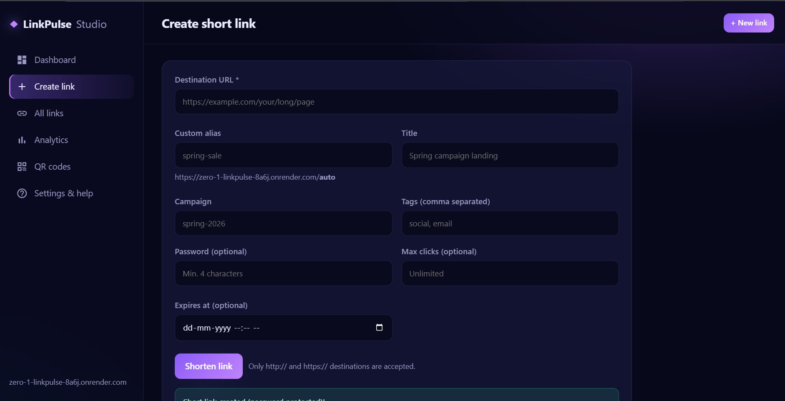
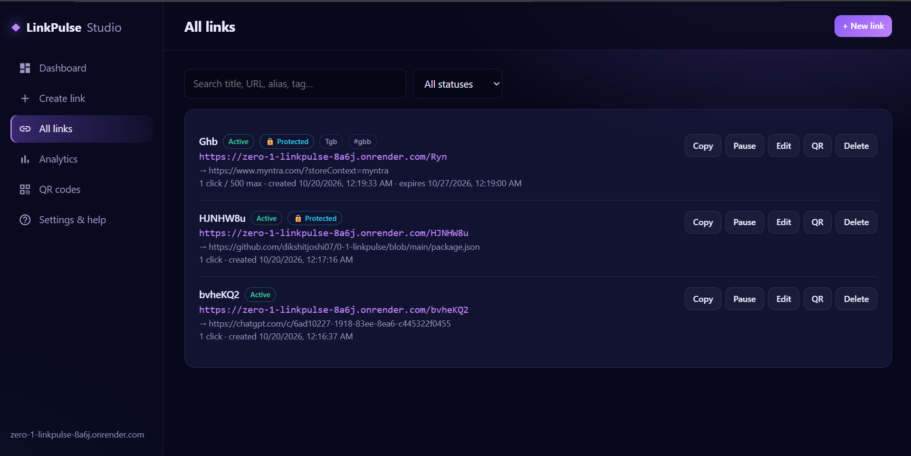

# LinkPulse Studio

**A modern URL shortener with smart link management, password protection, QR codes, and click analytics.**

LinkPulse Studio is a web-based link management platform designed to make long URLs easier to share, organize, and track. It allows users to create short links, customize aliases, protect links with passwords, set expiration dates and click limits, and manage links through a clean dashboard.

## Screenshots

### 1. Create Short Links
Create short links with a destination URL, custom alias, title, campaign, tags, optional password protection, click limits, and expiration dates.



### 2. Manage All Links
View and search saved links, check their status, and use available controls to copy, pause, edit, generate QR codes, or delete links.



### 3. QR Code Generation
Generate and download QR codes for short links, making them convenient to share in print and digital formats.


### 4. Settings and Help
View the short-link base URL, understand how redirects work, and review guidance about aliases, password protection, and security.


## Key Features

- **URL Shortening:** Convert long URLs into compact, shareable links.
- **Custom Aliases:** Create readable short links using unique aliases.
- **Password Protection:** Restrict access to selected destinations with password verification.
- **Click Limits:** Set a maximum number of successful visits for a link.
- **Link Expiration:** Set an expiration date for time-sensitive links.
- **Pause and Resume:** Temporarily disable or reactivate links.
- **Link Management:** Search, edit, copy, and delete saved links.
- **QR Code Generation:** Generate and download QR codes for sharing.
- **Click Analytics:** Track clicks and view available link statistics.
- **Campaigns and Tags:** Organize links for easier management.
- **Input Validation:** Validate destination URLs, aliases, and other supported fields.
- **Security Measures:** Use password hashing, HTTP security headers, and rate limiting.

## How It Works

1. Enter the destination URL and configure optional link settings.
2. Generate a short link with an automatic code or custom alias.
3. Share the short URL or its QR code.
4. Visitors are redirected to the destination if the link is active and any required password is verified.
5. Manage links and review available click statistics from the dashboard.

Paused, expired, or click-limit-reached links are treated as unavailable.

## Technology Stack

| Component | Technology |
|---|---|
| Backend | Node.js |
| Web framework | Express.js |
| Database | SQLite using Node.js built-in SQLite support |
| Frontend | HTML, CSS, JavaScript |
| Password hashing | bcryptjs |
| QR code generation | qrcode |
| Security headers | Helmet |
| Rate limiting | express-rate-limit |
| Hosting | Render |
| Version control | Git and GitHub |

## Project Structure

```text
0-1-linkpulse/
├── app/
│   └── app.test.js
├── database/
│   └── database.js
├── data/
│   └── .gitkeep
├── public/
│   ├── index.html
│   ├── app.js
│   └── styles.css
├── .gitignore
├── .node-version
├── package.json
├── package-lock.json
├── render.yaml
├── README.md
└── server.js
```

## Run Locally

**Requirements:** Node.js 22.13 or newer and npm.

1. Clone the repository:

   ```bash
   git clone https://github.com/dikshitjoshi07/0-1-linkpulse.git
   cd 0-1-linkpulse
   ```

2. Install dependencies:

   ```bash
   npm install
   ```

3. Start the application:

   ```bash
   npm start
   ```

4. Open `http://localhost:3000` in your browser.

## Live Demo

**Live Website:** https://zero-1-linkpulse-8a6j.onrender.com

**GitHub Repository:** https://github.com/dikshitjoshi07/0-1-linkpulse

## Security and Limitations

- Passwords for protected links are hashed before storage.
- Link creation and password attempts are rate-limited.
- Server-side validation is applied to supported inputs.
- Raw visitor IP addresses are not stored in click metadata.
- The dashboard currently has no login system. Anyone who knows its URL may be able to manage links, so it should not be treated as a private administrative interface.
- On hosting configurations without persistent storage, database records may be lost after restarts or redeployments.

## Future Improvements

- Dashboard authentication and role-based access.
- More detailed analytics and reporting.
- Exportable analytics reports.
- Improved team collaboration and link organization.
- Custom domains and enhanced deployment options.

## Author

**Dikshit Joshi**

- GitHub: [@dikshitjoshi07](https://github.com/dikshitjoshi07)

---

*LinkPulse Studio — Shorten links. Manage smarter. Track engagement.*
